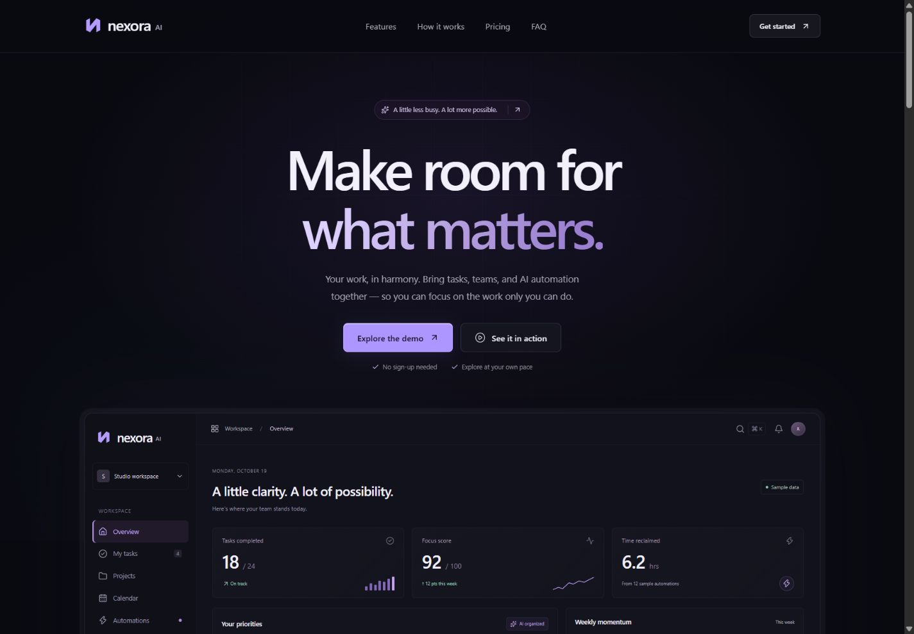

# Nexora AI

A premium SaaS landing page template built with React and TypeScript. It combines a custom productivity dashboard, varied feature illustrations and a typed customization system. Nexora AI and the optional FlowPilot example are fictional concept brands.



[Mobile preview](qa/release-mobile.jpg) · [Customization](CUSTOMIZATION_GUIDE.md) · [Deployment](DEPLOYMENT_GUIDE.md) · [Release report](PRODUCTION_RELEASE_REPORT.md)

## Features

- Responsive dark layout with local CSS/SVG artwork and subtle motion.
- Interactive task checkboxes, monthly/yearly pricing and calculated annual totals.
- Native FAQ disclosures, mobile navigation and keyboard-accessible workflow demo.
- Typed branding, content, theme, pricing, actions, SEO and section visibility.
- Optional FlowPilot preset with green accents, custom logo and two plans.
- Static head metadata and portable, Cloudflare or GitHub Pages asset paths.

**Stack:** React 19, TypeScript 6, Vite 8, Tailwind CSS 4 and Lucide. ESLint, Prettier and Node's test runner provide checks. YAML is development-only workflow validation.

## Local setup

Use Node 22.19+ and npm. The configured build line is Node 22. In the directory containing `package.json`:

```sh
git clone https://github.com/monExcalibur/nexora-ai-template.git
cd nexora-ai-template
npm ci
npm run dev
```

Open [localhost:4188](http://127.0.0.1:4188/). If occupied, use `npm run dev -- --port 4189`. Use HTTP rather than opening `index.html` directly. Stop owned Vite processes before reinstalling on Windows to avoid native-module locks.

| Command | Purpose |
| --- | --- |
| `npm run dev` | Development server |
| `npm run typecheck` | Strict TypeScript check |
| `npm run lint` | ESLint |
| `npm test` | Configuration, palette, pricing, action, metadata and deployment contracts |
| `npm run format:check` | Formatting check (`npm run format` applies it) |
| `npm run audit:publication` | Credential-pattern and local-asset audit |
| `npm run build` | Production output in `dist/` |
| `npm run preview` | Inspect the production build locally |

## Customization

Edit `src/config/siteConfig.ts` for branding, sections, demo mode, SEO and the local deployment default; `content.ts` for copy, plans, dashboard data and FAQ; `theme.ts` for accents, surfaces, typography and radii. `actions.ts` classifies internal, external, contact and demo actions. The original palette is preserved; a complete light-theme conversion is not promised.

[CUSTOMIZATION_GUIDE.md](CUSTOMIZATION_GUIDE.md) covers all supported fields. Select `VITE_SITE_PRESET=flowpilot` for the example. Copy `.env.example` to ignored `.env.local` for local overrides and restart Vite. Never store secrets in `VITE_*`; those values are public build inputs.

## Deployment

Cloudflare Pages connected to GitHub is the primary target: **`npm run build`**, output **`dist`**, Node **22**, root base **`/`**. `CF_PAGES=1` selects root hosting and rejects conflicting paths. Set production `VITE_SITE_URL` to the actual stable HTTPS homepage when known; temporary deployment URLs are not used as canonical metadata.

[DEPLOYMENT_GUIDE.md](DEPLOYMENT_GUIDE.md) provides exact scoped GitHub copy/check/push commands, Cloudflare settings, environments, automatic updates and custom domains. [PUBLISHING.md](PUBLISHING.md) covers the retained manual GitHub Pages alternative. Local builds otherwise retain `./`; repository subpaths remain configurable.

Hosting is not enabled. Connect this repository to Cloudflare Pages when ready; uploading source does not deploy a website. Only `dist` is hosted. This one-page anchor-based site needs no client router or backend.

## Demo limitations

The footer identifies the concept template; dashboard data, benefits and pricing are illustrative. Task state and the fixed workflow result are local and reset on refresh. No live AI inference, account creation, checkout, form submission or tracking service is included.

Demo mode keeps meaningful local actions. Client mode uses configured live destinations; missing/unsafe destinations show an unavailable explanation. Contact actions open email drafts and never send automatically. Turning demo mode off does not make fictional brands or sample achievements real. Reserved `.example` addresses are examples, not operational services.

The body requires JavaScript. No social preview image is bundled: configure a real licensed image and public URL if needed. Custom copy, themes, logos, counts and destinations require renewed visual/accessibility checks.

## Screenshots and verification

Build and preview, wait for entrance animations to settle and capture 1440×1000 desktop / 375×900 mobile views with menus/dialogs closed. Keep selected captures in `qa/`; raw screenshots/builds remain ignored. Inspect all sections at 320, 375, 768, 1024, 1440 and 1920px after customization.

[PRODUCTION_RELEASE_REPORT.md](PRODUCTION_RELEASE_REPORT.md) records current checks and limitations. Earlier PLAN/QA and template-upgrade records remain unchanged as dated history. They may be curated out of a separate presentation while retaining local copies and valid documentation links.

## License and attribution

Included illustrations use local React/CSS/SVG and system fonts. No stock photography or remote fonts are required. [ASSET_LICENSES.md](ASSET_LICENSES.md) describes assets and complete bundled third-party notices. React uses MIT; Lucide includes ISC and Feather-derived MIT notices. Choose a source-code redistribution license separately before offering template reuse.

Portfolio description: “Nexora AI is a responsive SaaS concept landing page with a custom dashboard, interactive pricing, accessible local workflow demo and typed customization. All brands, metrics and plans are illustrative.”
